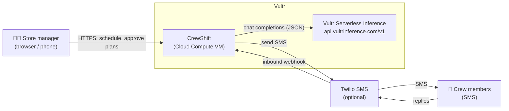
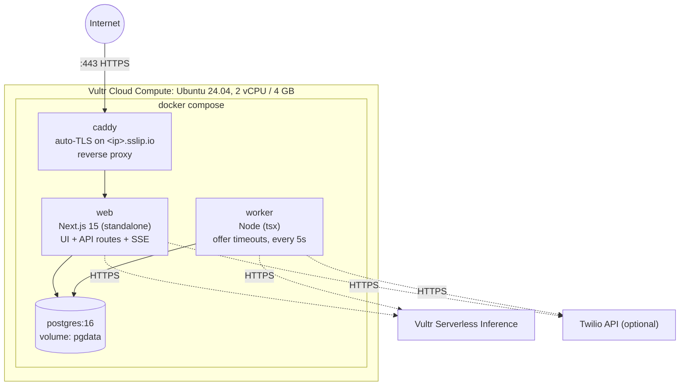
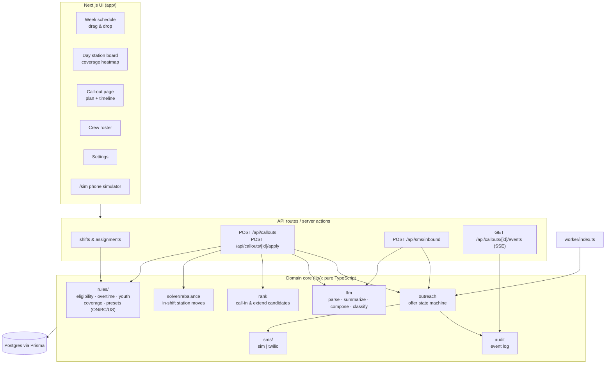
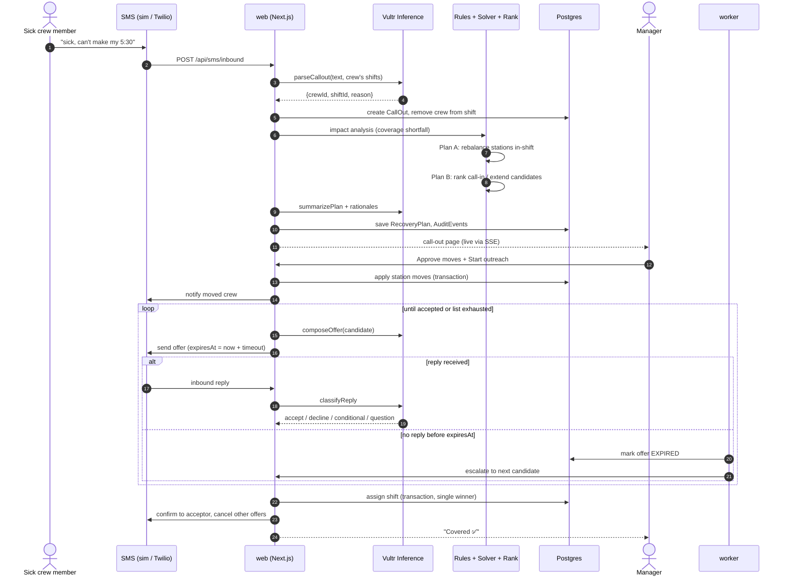
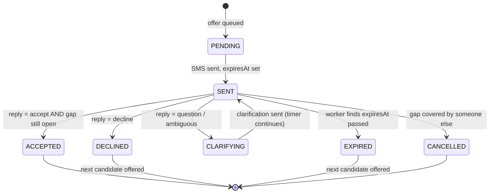
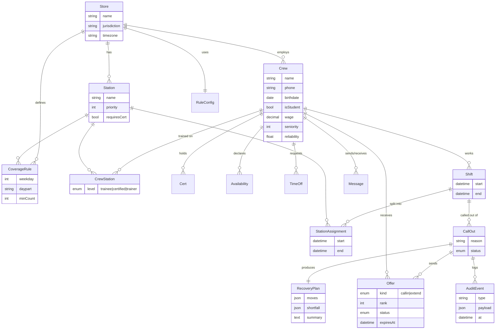

# CrewShift Architecture

CrewShift is the crew scheduling and sick-call recovery app for **Maple & Mug Coffee Co.**, a standalone coffee shop (fictional demo brand). Everything runs on **Vultr**: one Cloud Compute VM hosts the app, worker and database, and **Vultr Serverless Inference** provides the LLM.

See [plan.md](plan.md) for the product scope and [tasks.md](tasks.md) for the build checklist.

---

## 1. System context



The **phone simulator** (`/sim`) is used for demos. It stands in for Twilio and the crew's phones, so the whole flow works without a real SMS provider.

---

## 2. Deployment (single Vultr VM)



| Container | Role | Exposed |
|---|---|---|
| `caddy` | TLS termination, reverse proxy to `web:3000` | 80, 443 |
| `web` | Next.js pages, server actions, REST API, SSE, Twilio webhook | internal |
| `worker` | Expires offers and escalates to the next candidate | none |
| `postgres` | All app state | internal only |

Firewall: only 22, 80 and 443 are open. Secrets (`VULTR_INFERENCE_API_KEY`, `TWILIO_*`, `DATABASE_URL`) live in `.env` on the VM, never in the repo.

The upgrade path is to move Postgres to **Vultr Managed Database** and run `web` replicas behind a **Vultr Load Balancer**.

---

## 3. Application components



**Design principles**
- **Deterministic rules, LLM for language.** Eligibility, overtime, youth limits, coverage, the solver and ranking are pure functions with unit tests. The LLM never decides who is eligible. It only reads and writes human text.
- **Manager stays in control.** No schedule change or outreach starts without the manager's approval. Overtime needs an explicit checkbox.
- **Everything is auditable.** Every rule result, LLM input and output, message and decision is written to `AuditEvent` and streamed to the call-out page.
- **The LLM can fail safely.** Every LLM call is zod-validated with a timeout and a keyword/regex fallback, so the flow still works if inference is slow or returns bad JSON.

---

## 4. Sick call-out flow



---

## 5. Offer state machine



Call-out status: `OPEN → PLANNED → OUTREACH → COVERED`, or `UNFILLED` when no candidate accepts. In that case the manager sees the remaining shortfall and can pick someone by hand.

**One offer at a time:** outreach is strictly sequential. At most one offer per call-out is in `SENT` or `CLARIFYING` at any moment, and the next candidate is offered only after a decline or expiry.

**Double-accept protection:** acceptance runs in a Postgres transaction that checks `CallOut.status = OUTREACH` and locks the row with `SELECT … FOR UPDATE`. Only the first acceptor wins. Anyone later gets "Already covered, thanks!"

---

## 6. Data model



---

## 7. LLM usage (Vultr Serverless Inference)

All calls go through `lib/llm.ts` using the OpenAI SDK with `baseURL = https://api.vultrinference.com/v1`.

| Function | Input | Output (zod-validated) | Fallback |
|---|---|---|---|
| `parseCallout` | Inbound SMS + sender's upcoming shifts | `{shiftId, reason, confidence}` | Sender's next shift; asks to confirm |
| `summarizePlan` | Moves, shortfall, ranked candidates + rule reasons | Manager summary + one rationale per candidate | Template string from rule reasons |
| `composeOffer` | Candidate, shift, station | SMS text (≤ 300 chars) | Fixed template |
| `classifyReply` | Reply text + offer context | `accept \| decline \| conditional \| question` | Keyword match (yes/no/can't/sure) |

No secrets or unnecessary personal data go into prompts. Only first names, shift times, stations and rule reasons are sent.

---

## 8. Repository layout

```
app/
  (app)/schedule/week/        week grid (drag & drop)
  (app)/schedule/day/[date]/  station board + coverage heatmap
  (app)/callouts/[id]/        recovery plan, approvals, live timeline
  (app)/crew/                 roster
  settings/                   jurisdiction preset, OT, rest, timeouts, station priority
  sim/                        phone simulator
  api/callouts/…              create, apply, events (SSE)
  api/sms/inbound/            Twilio webhook + sim
lib/
  rules/  solver/  rank.ts  outreach.ts  llm.ts  sms/  audit.ts  db.ts
worker/index.ts               timeout/escalation loop
prisma/schema.prisma, seed.ts
docker-compose.yml  Dockerfile  Caddyfile
```
